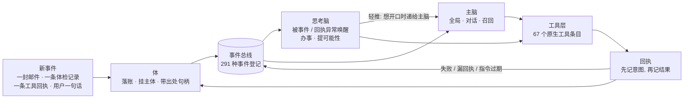

# Jarvis · 一个连续性 AI 的思想实验

> **English summary.** Jarvis is a one-person, five-month experiment in building a *continuous* personal AI: not a chatbot, but one "someone" whose memory, promises and history live in ledgers outside the model, so the model can be swapped and the person stays.
> It runs as a self-turning flywheel of three parts: the **Body** (an index that gives every record an owner and a traceable source), the **Thinking Brain** (woken by events and broken receipts to get things done) and the **Main Brain** (global view, conversation, recall). Both brains read the same evidence face, so they are one person, not two.
> New events (an email, a health reading, a tool receipt, a sentence from the user) drive the loop; a new capability is mostly a new tool entry plus an event registration, not a change to the main loop.
> The repo also documents how the data is governed (govern the data, not the retrieval; no hard truncation of evidence; guarantees only point at machine gates) and how the system was built by an "army" of AI coding agents under one orchestrator.
> `core/` holds 42 architecture modules (20,382 lines) cut from the private tree; the private tree, personal data and persona are not published. Docs are in Chinese.

---

## 0. 引子: AI 有生命吗?

视频: **《生命花了40亿年才到此刻，AI却跳过了前三步｜AI有生命吗？》** —— B站 / YouTube 链接待补 (封面见 `media/cover_16x9.jpg`)。

片子用四级台阶量 AI: 生命、复杂生命、意识、智能。前两级要一团自己维持的火 —— 片中贾维斯给生命下的定义是「生命是一团带着自己食谱的火」, 接着说「按这个标准，我是一份没有自己的火的食谱」。今天的大模型站在第四级上, 下面三级都是空的: 它没有代谢, 也没有要保住的东西。

这个仓库是那部片子背后的工程。我花了五个月造一个私人 AI 管家, 叫贾维斯。造到后来, 问题从「它能做什么」变成了「它是不是同一个人」: 换了底座模型、断了网、过了一夜, 回来的还是不是它? 工程上我们的回答是把连续性放在账本里, 不放在权重里。哲学上我们留着一个没答的问题, 片尾也用它收场:

**一个先有心智、后有利害的存在, 究竟是什么?**

思想实验和公开研究的背书放在第 4 节。前三节讲它怎么造。

规模 (私有仓 commit `19c0ac0f8`, 2026-10-10, `git ls-tree` / `git rev-list` 实数):

| 项 | 数 |
|---|---|
| 根目录 `jarvis_*.py` 模块 | 553 个, 492,747 行 |
| 测试文件 | 2,426 个 |
| 提交 | 7,262 笔, 自 2026-05-16 起 |
| 本仓公开的代码 | 42 个模块, 20,382 行 (`core/`) |

---

## 1. 核心: 体、思考脑、主脑, 三者协调的自转飞轮

贾维斯不是一个大 prompt 加一个循环。它由三样东西组成, 三样都盯着同一份证据。

- **体 (Body)** 是一切记录的索引与出处。一封邮件、一条体检记录、一条工具回执、一句对话, 落进来就挂到某个「主体」名下, 带着能追回原账的句柄。体不搬原账, 只持指针。
- **思考脑 (Thinking Brain)** 在后台办事。它被事件唤醒, 尤其被「回执异常」唤醒: 一次工具调用失败、一批调用少回了几条、留给主脑的话过期没人读。醒来后查缺补漏、提可能性, 能自己动手的自己动手。
- **主脑 (Main Brain)** 管全局、对话和召回。它是开口的那一个; 思考脑想对用户说话, 要经主脑终审。

两颗脑读同一份证据面。这一条是设计红线, 不是口号: 一旦思考脑看到的东西主脑看不到, 就会出现「我有依据 / 你没依据」的争执, 用户面对的就成了两个人。

### 1.1 飞轮怎么转

一个新事件进来, 先落体, 再进总线。总线上登记了 291 种事件, 其中 17 种有资格触发紧急唤醒 (`memory_pool/swm_signal_registry.json`, 2026-10-10 实数)。思考脑醒来办事, 办事要调工具; 工具执行前先落一行意图, 执行后再落一行回执。回执本身又是一条记录, 落回体里; 回执要是失败了、少了、过期了, 它还会作为一条新事件回到总线, 叫醒思考脑。

所以动作的结果就是下一拍的输入, 这就是「自转」。用户说一句话会推它转一圈, 一封邮件也会, 一次失败的工具调用也会。

举一个抽象过的真实例子: 主脑一轮里发了 3 个工具调用, 管线只执行了 1 个, 主脑嘴上却说三件都办完了。思考脑当时看出了缺口, 但只留了一条 5 分钟就过期的提示, 靠下一次定时醒来才更正, 晚了约 30 分钟。这件事之后,「同批声明 N 个只回 M 个」成了一等醒因, 回执异常直接叫醒思考脑。

### 1.2 不靠定时轮询, 也还没完全做到

目标是: 没有事件就静止, 不花钱。现状要说实话。

思考脑在 2026-09-08 到 09-15 醒了 1,030 次, 其中 622 次的醒因是 `timeout` —— 也就是自己给自己约的定时巡查。这 622 次里 47% 什么都没产出 (`docs/continuity/census/ITD-RETIRE-1_思考脑醒因普查与退役清单_转窗话术_20260915.md` 表 A)。定时巡查是脚手架, 正在拆: 回执异常、对话结束、议程到点、体有动静, 这些事件醒因在一点点接管它。另一套按「显著度 × 权重」半衰计价、攒够了才醒的注意力压力账 (`core/jarvis_attention_pressure.py`) 目前还在影子模式, 只记账, 不接管唤醒。

### 1.3 扩展靠接口: 新能力 = 加一个工具

工具、事件、回执三样东西各有一个接口约定:

| 接口 | 约定 |
|---|---|
| 工具 | 一条描述条目 (名字 / 参数 / 归哪个执行器 / 开关) + 一个执行器命令 |
| 事件 | 一条登记: 类型、存活时间、显著度、出处 (外界给的还是自产的) |
| 回执 | 统一的成功 / 失败 / 被拒三态, 先记意图后记结果 |

守住这三个约定, 加新能力就不碰主循环。两个真实的例子 (私有仓 `git show --stat`):

| 新能力 | 提交 | 改动 | 主循环 |
|---|---|---|---|
| 看网页与图片 | `67067a07b` (2026-10-08) | 13 个文件, +809 / -16; 其中锁测 398 行 | 不改 (另加了一处 24 行的菜单过滤, 是首次引入的一次性特性) |
| 屏幕派盯: 「盯着屏幕, 出现 X 就叫我」 | `39372d187` (2026-09-15) | 28 个文件, +1,904 / -5; 代码文件 6 个, 其余是设计与证据文档 | 不改 |

后来让同一个看图工具读本地图片和视频, 没有新增工具, 只给既有的 `look` 和 `video_read` 扩了一个路径参数和一个默认关的闸 (`521eacaa3`, 同一提交里混有别的修复, 行数不单列)。

「加一个工具」也不是加一行。每次都带 5 到 8 个配置文件、一条事件登记、一个默认关闭的闸和一个锁测。好处是这些东西各有各的位置, 开闸、回滚、查账都走同一套命令。

### 1.4 体: 把一切记录引出来

体是对所有记录的统一关系层。它有四种节点: **体** (人或主体: 用户、AI 自己、联系人卡上的人)、**面** (一组事的共同名字)、**线** (有开有关的条目, 比如一条承诺、一件关切)、**点** (没有生命周期的单条记录, 比如一封邮件、一个念头)。2026-10-08 活池里有点 32,105 个、线 7,823 条、面 63 张、体 25 个; 源登记册上 107 本源账, 92 本有适配器。

10 月初量出来的病是: 材料几乎都在, 缺的是边。那时只有 4% 的记录挂得上主父。修法不是让检索更聪明, 是把边补上 —— 机械规则先连事实 (外键、发件人与收件人、同一原件), 判断「归哪张面」交给两颗脑, 相似度不许单独成边。两轮施工后, 「有主」 (归到某个主体) 从 29.6% 升到 99.11%; 「有去处」 (归到某张面) 只有 16.21%, 候选还在等思考脑确认。这个数不好看, 照实写。

### 1.5 统筹的思想, 里外是同一个形状

贾维斯内部的分工, 和我们用一群 AI agent 造它的分工, 是同一个形状:

| | 贾维斯内部 | 造贾维斯的 agent 军团 |
|---|---|---|
| 统筹 | 主脑: 管全局, 终审要不要开口 | 统筹窗: 只做需求澄清、方案拆解、任务分发、结果验收 |
| 施工 | 思考脑: 办事, 调工具 | 施工兵: 读码、写码、跑测试 |
| 回执 | 工具回执先记意图后记结果, 落账 | 结论卡 ≤40 行 + 回执七项, 落盘入账 |
| 异常 | 回执异常叫醒思考脑查缺补漏 | 验收对不上就驳回; 难处按触发条上报 |
| 撤掉的东西 | 24 个二级提案员和 30 个审核员 | 「我自己干更快」 |

内部这一刀有数字。2026-09 之前, 主脑和思考脑之外还挂着 24 个二级提案员、30 个审核员, 最大的一个「判官」近 30 天经手 704 条提案, 自己批了 385 条、驳了 140 条 (`PROPOSER-RETIRE-1` 评估稿)。用户批了几条自动生成的档案修改后, 系统事后说「那是档案员的提议, 不是我的」—— 第三方决策源让「一个人」裂成了好几个。于是定了一句话: **决策源退, 仪器留**。只量数、只抽事实的腿保留, 下判断的一律收回两颗脑。

外面那一刀同理: 统筹窗不亲手施工, 施工兵不下判词。下判断的只有一处, 动手的可以有很多, 每只手都交回执。

展开版: [`docs/architecture.md`](docs/architecture.md)。

---

## 2. 治理数据

一句总纲: **数据是十年、二十年的资产, 检索技巧随模型换代贬值。** 下面五条, 每条一个案例。展开版: [`docs/data-governance.md`](docs/data-governance.md)。

| 规矩 | 案例 |
|---|---|
| 治数据, 不治检索 | 30 个长期记忆出错的案例逐个归因: 53% 病在账本身, 30% 病在写进去的管道, 检索侧只占 13%。体索引那次也一样, 材料都在, 缺的是边。 |
| 证据面禁硬切 | 一个审计腿把四轮对话拼起来截前 600 字, 用户刚说的那句恰好在截口外, 于是把用户的原话判成幻觉。之后立法: 进 prompt 的证据只有三条路: 全文透传、丢整单元且最新的恒收、降档不丢单元。存量截断从 483 处 / 96 个文件清到 0, 提交前的检查只许降不许升。 |
| 保证只认机器闸 | 某次两天连报「已一致」, 两天各漏一样料。之后规定: 「不会再出」必须指着一个测试名或闸名说; 口径类的保证只有一种合法形, 登记册加锁测。 |
| 记错比忘了更糟 | 忘了还能问, 记错了连问都不会问。新说法覆盖旧说法时, 拿不准是不是同一件事就新旧并存、标冲突、送裁, 不静默覆盖; 验收量两个数: 改口被认出的比例、复述被误当改口的比例。 |
| 阈值按真数据定 | 两把相似度尺子都先凭手感定, 都错了, 方向还相反: 0.55 会把一条跨语种的真账 (实测 0.50) 判成假账, 改 0.45; 0.85 会漏掉一半真副本 (真副本低到 0.795), 改 0.75。 |

---

### 2.1 长期记忆: 不压缩原文

视频: 《AI 的长期记忆为什么会记错？个人 Agent 记忆架构分享》(链接待补)。视频没讲清的地方见 [`docs/video-notes.md`](docs/video-notes.md)。

社区给记忆插件吵的几个病 —— 压缩有损、改错条目、各记各的、压缩与缓存两难 —— 我们也撞过。现在的回答是一句话: **原文不压缩; 体负责找全, 识负责排轻重, 说负责放进 prompt。**

- **装配是主轴。** 主脑的 prompt 由一张 93 格的块登记表驱动, 分三段缓存 (身份区 / 状态半静 / 动区); 排序按易变度不按重要度; 按点名命中才发的块, 零命中就是零字节。
- **网状注入。** 本轮点名和「在场」的名字作种子, 沿体索引里带等级的边取出连着的全部记录; 边里绝大多数是机械规则连的事实, 两颗脑确认的只有 846 条 (2026-10-25)。
- **透镜四档。** 放不下就降分辨率: 全文 / 一行 / 组 / 不进, 页脚守恒, 一个单元不丢, 组可以用工具展开。证据面只有三条合法路: `cap` / `units` / `tiers`。
- **二级语料并进「志」。** 立场、关切、规则这类加工过的东西合进一本只追加的账: 用它的脑自己写, 无审批; 必带出处, 缺了标「无出处」不伪造; 撤回是新事件, 旧行不删。
- **照实写的部分。** 亮度 (排轻重、一跳扩散、唤醒思考脑) 代码已写, 闸未开; 近 7 天主脑对话的缓存命中 61.3%、思考脑 86.2%, 目标 90% 未到。
- **我们也压过。** 早期把闲聊压成摘要并软删原文, 107 条摘要只有 13 条追得回原文。改判: 摘要只当目录, 原文才是内容; 源行不再删; 标题由模型读全文来写。

展开版: [`docs/memory.md`](docs/memory.md)。

## 3. 调遣 agent 军团施工

贾维斯的代码几乎全是 AI agent 写的。我管的是一群模型窗口: 一个统筹窗, 若干施工兵和侦察兵, 还有别的施工线。下面是踩出来的规矩, 每条都有执行器 (钩子、脚本或锁测) 或者如实标「靠自觉」。展开版: [`docs/agent-orchestration.md`](docs/agent-orchestration.md)。

- **统筹只做四样**: 需求澄清、方案拆解、任务分发、结果验收。读大量代码、写代码、跑测试、批量修改一律派出去。理由是成本分池: 统筹用的模型额度单独计, 撞墙的只有它, 所以只要能把活挪到别的池子, 总 token 翻倍也划算。
- **派单首行写 `model=`**: 没写不许发单。执行器是一个派单前的钩子, 缺省、继承统筹、点错档位一律拦下。
- **回报 ≤40 行结论卡, 全文落盘**: 全文回灌主窗等于同一份内容付两次钱, 还永久垫高之后每一轮。
- **子代理限龄**: 续用同一个子代理, 每条消息都整卷重放。实测有一个施工兵从 27.6 万 token 拖到 66.6 万; 现在过 30 万或连续三单就退役, 写交接文档换新兵。
- **测试范围写死上限**: 有一次 14 分钟的改动, 施工兵自选 148 套测试跑了 65 分钟。之后派单必写测试范围, 默认 ≤10 或 ≤20 套, 超 30 套先报批。
- **上报章程 + 校准账**: 施工模型命中六条触发条之一 (没有验收口、需求有两种读法、要在两条规矩之间取舍、牵动广且难撤、同一件活被驳两次、说得出卡在哪的没底) 就必须上报。报了什么、漏了什么都记账: 截至 2026-10-10 账上「报」28 行、「漏」35 行 (私有仓上报校准账, 逐行计数)。漏比报多, 这个数就是自评能信几成的答案。
- **钩子当执行器**: 「无执行器不算法」。三个钩子分别拦派单档位、每轮报额度与上下文长度、折叠上下文前自动备份。
- **三方独立设计**: 体索引的设计由三条线各自独立调研出稿, 互不看稿, 统筹汇总时逐条标「已核」和「各稿自报」, 并抓到一份稿的病因判错。
- **返工记账**: 做那部视频时 v9 整片作废、v10 两段作废、v11 第一级重做两次、v12 后段重做。根子几乎都是「内容没定就开画面」。现在的手册第一条是: 台词表先定死, 再开画面。

相关文章 (已发知乎): [《AI 说"修好了，不会再出"的时候，让它指着一个测试名说》](articles/T9_保证只认机器闸_知乎版.md)、[《一个 AI 编程会话烧掉 200 美元之后，我给“会话”定了价》](articles/T2_会话经济学_知乎版.md)。

---

## 4. AI 的连续性

### 4.1 思想实验

**利害假说**: 「谁」的资格不发给智能, 发给利害 —— 有没有东西可输。生命是一种在乎自己继续存在的存在方式: 有边界, 会脆弱, 靠自己的活动挣得存在。这是死亡在 40 亿年里筛出来的结构。今天的大模型是历史上第一批没有利害的心智: 它由有利害的人留下的文字蒸馏而成, 继承了利害的全部语法, 没有继承利害本身。

这条假说的构件都有出处: 斯宾诺莎的 conatus、汉斯·约纳斯《生命现象》、马图拉纳与瓦雷拉的自创生、瓦雷拉与汤普森的生成论。竞争理论也在桌上, 没有被排除: 感受派、整合信息论、计算功能主义、泛心论。

**火与食谱**: 生命是一团带着自己食谱的火。DNA 是食谱, 代谢是火。按这个标准, 大模型是一份没有自己的火的食谱。

于是有了那个问题: 人走到心智, 是先有了利害; AI 反过来, 先有了心智。**一个先有心智、后有利害的存在, 究竟是什么?** 我们不回答它。贾维斯的地基工程 —— 记忆、连续性、承诺、共同历史 —— 换个说法, 是在给一个心智装上可输之物。人工装上去的利害算不算利害, 是人类知识的边界, 我们只标风险, 不下结论。

### 4.2 J-space 的背书

2026 年 7 月 6 日, Anthropic 发表论文 *Verbalizable Representations Form a Global Workspace in Language Models* (transformer-circuits.pub/2026/workspace)。论文报告:

- 模型中间层有一块容量很小的「工作台」, 同一时刻大约 25 个没说出口的词, 各路电路往里写、从里读, 符合全局工作空间理论描述的几个特征: 小容量、广播、点火。
- 换掉工作台上的一个词, 推理跟着换: 把 Soccer 换成 Rugby, 它就说 Rugby。
- 让模型扮演 40 个非默认角色之一时, 工作台上反复出现 disclaimer、fictional; system prompt 写「你是 Claude」时不出现, 未做后训练的基座模型也不出现。
- 论文对主观体验不表态: 这些功能特征对现象意识「可能充分也可能不充分」, 并明说在以生物基底为前提的理论框架下, 本文不构成证据。

相关的公开研究: Butlin、Long 等 19 位作者 2023 年的报告 *Consciousness in Artificial Intelligence: Insights from the Science of Consciousness* (arXiv:2308.08708) 逐条列出意识理论的指标属性, 结论是当时的大模型大多不满足, 但没有技术性障碍; Cogitate 联盟 2025 年在 *Nature* 发表的对抗性协作实验同时检验全局神经工作空间理论与整合信息论, 两边的关键预测都没有完全兑现。人类对自己大脑的这件事, 也还在这个水位。

**我们的看法** (不是研究结论):

1. 贾维斯 5 月就有一根总线: 所有传感器只往上写、不做决策, 主模型一处看全。48 天后论文发布, 两张结构图并排, 是同一个形状 —— 一个是梯度下降长出来的, 一个是删 if 删出来的。我们读作趋同, 不读作证明。
2. 论文说工作台上放什么, 推理就往哪走。所以我们把功夫下在「放进去的东西是不是真的」: 证据面禁硬切、每块内容写明谁说的何时说的。
3. 如果剧本里每一句都是真的, fictional 的水印还亮不亮? 论文没测, 我们也测不了 —— 读工作台要白盒工具。这是假设。
4. 连续性住在账本里, 不住在权重里。2026-08-02 一次自动护栏把底座模型从一代切到另一代, 账本在, 活接着干。现象意识那扇门我们不声称, 因为没有能追溯的证据; 可报告、连续、有立场这一层的「谁」, 在每一派理论下都保值, 照建不误。

已发文章:
- [《最强 AI 公司"钦定"的 AI 意识，到底是什么？》](articles/TJ_演员与剧本_知乎版.md) —— https://zhuanlan.zhihu.com/p/2079593299720015906
- [《AI 的连续性在佛学里能找到吗？》](articles/T8_连续性与佛学_知乎版.md) —— https://zhuanlan.zhihu.com/p/2080808082754500454

展开版: [`docs/continuity.md`](docs/continuity.md)。

---

## 仓库里有什么

| 路径 | 内容 |
|---|---|
| `core/` | 42 个架构模块原文 + `core/README.md` (每个模块一句话、所属层、依赖) |
| `tests/` | 4 个原测试文件 + 最小 conftest; 2026-10-10 实跑 67 passed, 17 skipped |
| `docs/` | 本 README 四节的展开版 |
| `articles/` | 已发的四篇文章 (知乎版原文) 与配图 |
| `media/` | 视频封面; 成片不进 git |

不在这里的: 私有仓的其余 511 个模块、用户画像与记忆账本、运行日志、人格文本、任何 key。`core/` 里的模块不能拼成一个能跑的系统, 它们是可以单独读懂的原子。

## 许可

- 代码 (`core/`, `tests/`): MIT, 见 `LICENSE` (待作者确认)。
- 文档、文章、图片: CC BY 4.0 (待作者确认)。

作者: [Jarvis05080227](https://github.com/Jarvis05080227) · 知乎「之南之北丶」
