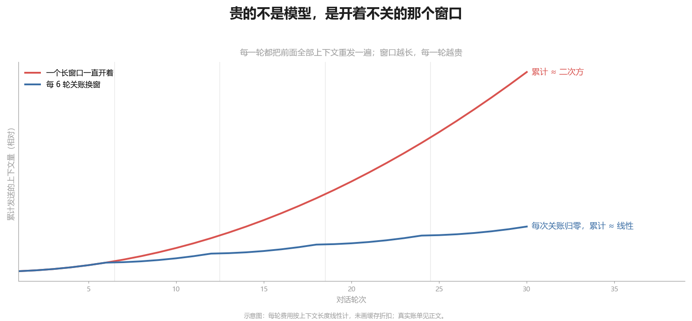
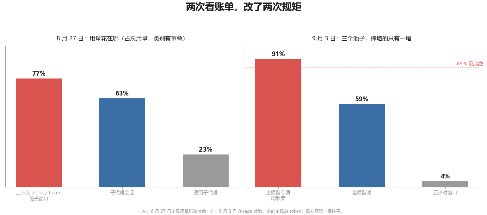

# 一个 AI 编程会话烧掉 200 美元之后，我给“会话”定了价

用 AI 写代码的人对账单只有一种感受：贵。贵的原因一般归到模型头上，于是换便宜的模型、加缓存、少问几句。我一开始也这么想，直到 6 月 23 日一个会话烧掉 200 美元，我去看它到底花在哪。

不在模型，在窗口。那个会话里边设计边施工，几个文件被整文件反复重发。每一轮，工具都把前面全部上下文重新发一遍给模型；窗口越长，每一轮越贵，累积下来接近二次方。一个长窗口每一轮的花费，够一个短窗口从头到尾。

从那天起，我把"会话"当成有价格的资源来管，规矩是被账单一条条逼出来的。

贾维斯是我一个人写的私人 AI 管家，31 万行 Python，5 月中旬到现在 5,736 次提交，103 个有提交的日子平均一天 56 次，最多的一天 375 次。代码几乎全是 agent 写的，我的活是提需求、拍板、验收。

## 钱的账

8 月 27 日我把工具的用量账单拉出来看，三个数：77% 的用量发生在上下文超过 15 万 token 的长窗口；63% 来自子代理会话；23% 花在通用子代理上。对着这三个数立了五条。

一案一窗，关账即清。一个案子做完，把结论、落点、没做完的事写进一份转窗话术，然后清空窗口重开。禁止在已经超过 15 万 token 的窗口里追加新案：长窗每一轮都整卷计费，缓存也只是打个折。三个多月下来，转窗单和施工册写了 359 份。

子代理的产物落盘，回报只给结论卡。那天之前我让六路侦察子代理把结果全文回灌主窗，主窗被垫肥了几十万 token，之后每一轮都在为这几十万付款。改成：产物写文件，回报不超过 40 行，主窗需要细节自己去读片段。

长寿子代理退役。续用同一个子代理，每发一条消息它都把自己的全部历史重放一遍，有一个施工兵从 27.6 万 token 拖到 66.6 万。规矩：过 30 万或连续三单就退役，写交接文档，换新兵冷启动。冷启动比拖着旧卷便宜。

另两条小的：追加指令攒成一条发，别五条小消息各触发一次重算；给自己的中间汇报写短。五条归成一条：token 只该在第一次产生信息的地方花，复述、回灌、重放都是给买过的东西二次付款。

9 月 3 日又改了一次账本。用量是分池的：主模型的专项周额度用到 91%，全模型池才 59%，五小时窗口 4%。撞墙的只有一堵。于是算账的办法换了：省的不是总 token，是主模型那个池子。只要能把活从主模型挪到便宜的子模型，总 token 翻倍也照做。以前"我自己干更快"是不派活的理由，现在快的是墙上的钟，贵的是那个池。

## 树的账

多个窗口同时改一个仓库，git 会出另一种事故。8 月 14 日到 29 日，同一类事故我记了十一例：暂存区是全树共享的，一个窗口 add 进去的文件被另一个窗口的 commit 带走，不报错，静默发生，内容不丢但归属挂错车。第七例发现按路径限定 commit 也挡不住同一个文件上的交叉；第九例发现 `git commit -- 路径` 提交的是工作树，连没有 stage 的、别人正在改的半截改动都会卷进去。

更狠的一次在 8 月 26 日。一个窗口想暂存自己的改动，敲了 `git stash push`，卷走 188 个文件、6,725 行，全是各个窗口正在飞的改动。

规矩从这些里长出来。`reset --hard`、`checkout --`、`stash` 三把刀在这棵树上永不使用，复原只用编辑器反向改回去。commit 逐个点名文件，add 之后、commit 之前必看一眼暂存区里多出来的是不是别人的。判断另一个窗口在不在某个文件上，用 `git diff HEAD -- 文件`，因为 `git diff 文件` 会骗人。脏树是常态，告知一次然后继续干，不停工等别人清。不 push，等真机验过、验收报告看过。

## 岗位的账

第三本账是 9 月 3 日定的。主会话只做四件事：需求澄清、方案拆解、任务分发、结果验收。读大量代码、写代码、跑测试、批量修改，一律派给子代理，不按活的大小挑拣，不派的那次要给理由。主会话亲手做的只剩三类：不可逆的外向动作，比如 commit；一行级的微活，比如查一个键值；以及判词本身，比如写给下一个窗口的转窗话术。

这三本账最后收进一份 24 KB 的入口章程。9 月 5 日给它上了一把锁：文件超过 24 KB 提交被拒，新增一条规矩必须删掉等量的旧规矩，删掉的规矩要在退役册里立一块碑。章程从此只能变短。

两个多月前那个 200 美元的会话，按今天的规矩会被拆成一串窗口。我没算过拆开之后总共多少钱，多半没省多少。省下的是另一样东西：每个窗口结束时都知道自己做了什么、没做什么，下一个窗口从一份两页的话术冷启动，省掉在 15 万 token 的记忆里翻找。
