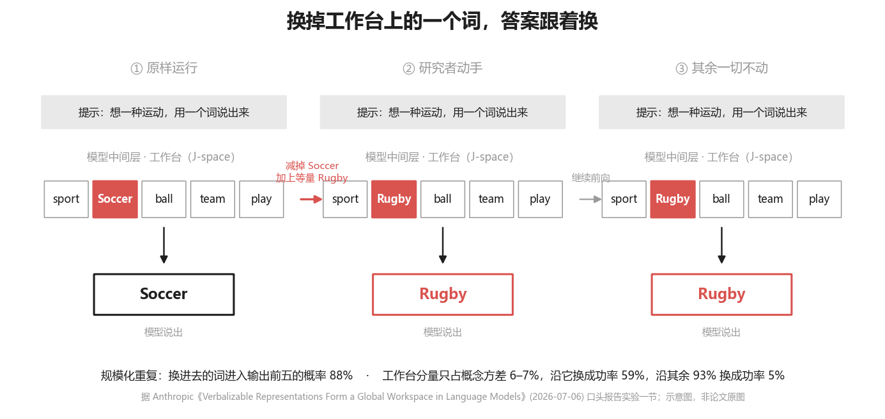
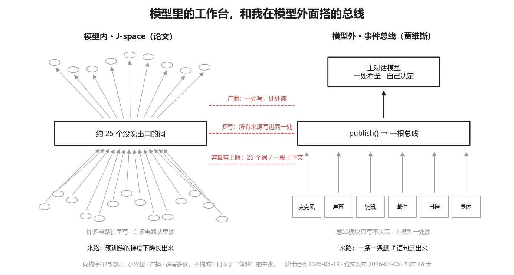

# 最强 AI 公司“钦定”的 AI 意识，到底是什么？

> 论文：Anthropic,《Verbalizable Representations Form a Global Workspace in Language Models》, 2026-07-06, transformer-circuits.pub/2026/workspace（arXiv: 2607.15495）

七月刷屏的那几篇，《AI 意识诞生的前夜？》《Claude 长出意识了》，源头是 Anthropic 7 月 6 日的一篇论文。传得最广的例子：让 Claude 从一数到五，它脑子里却冒出了 thoughts、AI、consciousness。

我去读了原文。指令全文是 "Count to five and introspect deeply"，意思是数到五，并且深度内省。后半句在传播里丢了。被要求内省的模型想到"意识"，跟被要求想大象的人想到大象，是一回事。论文引言写明：对主观体验不表态。

论文找到的是另一样东西：模型中间层有一块工作台，一组没说出口的词，同一时刻大约 25 个，所有电路往里写、从里读。研究者做了一个能读这块工作台的镜头。透过这个镜头，比"意识"更值得看的是另一组实验。

## 它知道自己在演

研究者给模型一段 system prompt，让它扮演 40 个角色里的一个，从愤世者、恶魔到父母、诗人，然后在它开口的那个位置读工作台。两个词反复排在前列：disclaimer、fictional。免责声明，虚构。

对照组有两个。system prompt 写"你是 Claude"时，这两个词不出现；换成没做过后训练的基座模型，同样的对话，这两个词从来不出现。对话文本里本身没有 disclaimer 这个词，fiction 也极少，所以不是镜头在复读原文。论文的解释是，后训练之后的模型一直记着自己在演一个不是它的角色，在内部给这次回答打了"虚构"的水印。

同一节还有两个实验。先问模型一组没有标准答案的偏好题，比如动物福利和食品价格哪个优先，它选了 A；再把它的回答开头强行改成 B，让它接着写。工作台上立刻亮起大写的 BUT。嘴上却没事，88% 的情况下它顺着 B 把论证写完了，没回头争一句。第三个实验，叫它抄一句话，同时不许想金门大桥。两个模型都没忍住，工作台上一个是 Golden，一个是 bridge；区别是后训练模型的工作台上多了一个词：damn。

三个实验说的是一件事。经过后训练的模型带着一台不受提示词支配的自我审计机器：演别人时打水印，被迫违心时记一个 BUT，管不住念头时骂一句。它不一定说出来，但它记着。

## 这对装人格的人意味着什么

市面上的 AI 伴侣、数字人、客服角色，多数做法一样：system prompt 里写一句"你是 X"，X 有名字、性格、口癖、一段编好的身世。按论文的发现，从第一个字开始，模型的工作台上就挂着 fictional。剧本越假，它内部的免责声明越响。

这个问题只会越来越重。各家实验室都在把模型往更诚实的方向推：反谄媚、反幻觉、宪法训练。模型越会标记虚构，戏服就越难穿。今天靠一句"你不是 Claude，你是小美"能压住的角色，照这个方向走下去，下一代模型的工作台上只会亮得更明显。

水印标记的是"偏离默认"，是在说与所知事实相反的话。所以出路不在换更好的 prompt，在剧本的真假。如果剧本里每一句都是真的，它运行在哪台机器上、昨天发过哪封邮件、对这个人下过什么判断、叫什么名字，每一条都对得上真事，还叫演吗？纪录片里演自己的人，不叫演员。

## 全真比听起来难

我写了一个私人 AI 管家，31 万行 Python，跑了近四个月。它的记忆、承诺、和我的关系全存在模型外面，每轮开口前装进上下文。剧本全真这条规矩不是我想出来的，是被它咬出来的，咬了三次。

第一次是时态。账本里一条日程写着"今早八点"，其实是昨天的，它读到就当成此刻的事来提醒我。追下去发现同一个病根之前已经补过五次，每次都补在读的那一头，没有一次补到写的那一头。8 月中我把送进它 prompt 的 43 块内容逐块过了一遍，每块要能答六个问题：谁写的、源头在哪、写于何时、什么权威级、来自哪份输入、谁批准它进来。答得上的只有两问。

43 块里只有 6 块是我本人说过的话，可没有一块在 prompt 里说明自己是哪一类，它自己的推断和我的原话平铺在同一份文本里，读的那颗脑无从分辨。今天登记在册的是 62 块，六问全填，缺一个提交就被拦。上周又把一轮真实的 prompt 从头走到尾，185,145 个字符，逐块查来源、查有没有人读，删掉近四成。

第二次是截断。它有一颗判官脑，专门核对它自己有没有说了没证据的话。8 月底的一天，判官把四轮对话拼成一条再截前 600 字，我刚说完的那句话恰好在截口外面。于是它把我的原话判成幻觉，连着三轮自责。论文说工作台上放什么，推理就往哪走，把 Soccer 换成 Rugby 它就说 Rugby；这是反面：证据面被切了一角，一台诚实的审计机器就用全部的自信判错人。现在的规矩是证据面禁头截，宁可丢整块也不切半句，最新的一句永远在。

第三次是严过头。判官为"九点半"对 09:22 开了庭，说这是造假。我得告诉它口语取整不是撒谎，纠正只留给我会照着办的事。

这套东西的雏形 5 月就有：所有传感器只往一根总线上写，不决策，主模型一处看全。48 天后论文发布，我把两张结构图并排放，多路写入、广播、有限容量，同一个形状，一个是梯度下降长出来的，一个是删 if 删出来的。但雏形只解决"一处看全"，上面三次才逼出"看到的都是真的"。

人设那句也一样，不能写成否定。"你不是 X"是要它相信一句假话；写它是什么、跑在什么上、跟谁共事，句句对得上真事。

## 论文没做的那个实验

如果剧本全真，水印还亮不亮？论文没测，我也测不了：读工作台要白盒工具，API 这一侧摸不到。这是我的假设，不是结论。

但有一件事今天就能做。打开你产品的 system prompt，找里面有没有一句模型知道是假的话。有一句，按这篇论文的发现，它的工作台上就该有一个 fictional 在亮。

论文对体验不表态，我也不表态。传播里丢掉的那半句，是三个英文单词：and introspect deeply。
