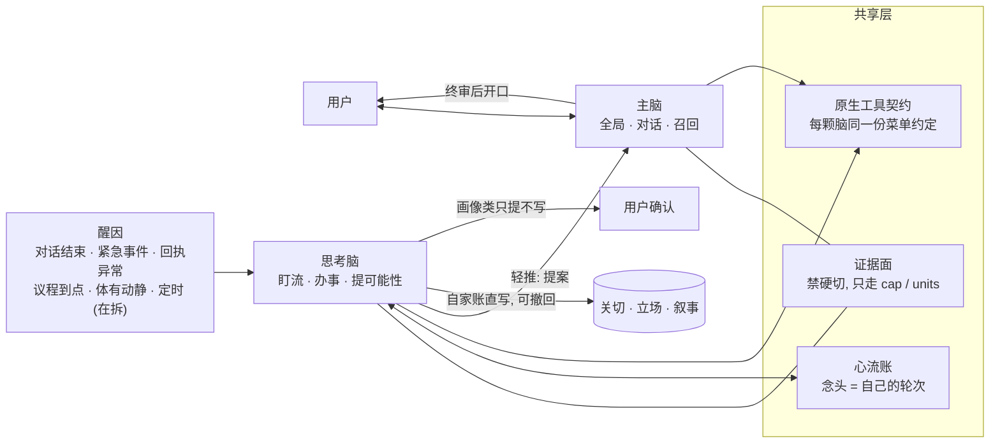
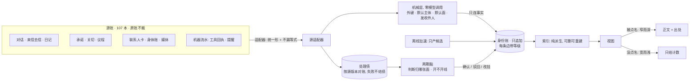

# 架构形态 (README 第 1 节展开)

> 数字除另注外取自私有仓 commit `19c0ac0f8` (2026-10-10) 与其中的施工记录; 记录日期写在数字旁。示例里的人和事都已抽象。

## 1. 三样东西, 一份证据

贾维斯由体、思考脑、主脑三样东西组成。它们分工不同, 但读同一份证据面。

为什么这一条要立成红线: 2026-09 初, 一个专职审计「这句话有没有依据」的判官, 审一句话时自己另拼一张证据面, 而说话的那颗脑面前摊着 14 到 22 万字符的 prompt。判官看到的只有说话人的 5% 到 8%, 凡是说话人引用的依据落在判官没拼进去的那一块, 就判冤。09-01 到 09-04 一审的 254 个标记, 二审翻掉 63% (`core/jarvis_desk_register.py` 头注)。修法不是给判官再补一路料, 是让它直接读说话人那一轮的同一份 prompt。

两颗脑也一样。思考脑看到而主脑看不到的东西, 会变成两种说法; 用户面对的就是两个人。

## 2. 双脑: 主脑与思考脑

### 是什么

- **主脑**是对话脑, 管全局和记忆召回。用户说话, 它回答; 思考脑想开口, 由它终审。
- **思考脑**是后台常驻的内心进程, 管解决事务、主动盯着事件流、提出可能性和备选。它的念头写进一本只追加的「心流账」: 念头是它自己的轮次, 外界的变化是对面的轮次。私有仓里它的主体加周边模块共 36 个文件 (主体 4,599 行, 另 35 个 `jarvis_itd_*.py` 合计 36,914 行, 2026-10-10 `wc -l`)。
- 两颗脑共用一份原生工具契约。2026-09-09 统计, 思考脑白名单 34 把工具: 10 把只读, 20 把带证据才可写, 1 把需确认, 3 把未分类; 另明禁 26 把。

### 为什么这样分

设计意图写在 2026-09-26 的一次分工里: 思考脑的主要职责是解决事务、提供可能性, 主脑主要是总揽全局和召回; 两者证据面一致, 双脑同人不能破。

动机来自一次普查: 思考脑放下一件事时, 留下 88 条「什么时候重新打开」的条件, 多数写成「等用户自己提起」—— 它把关心托付给了用户开口, 而不是自己盯着。分工之后, 盯流是思考脑的本职。

### 解决了什么

**第三方决策源退役。** 2026-09 之前, 两颗脑之外还有 24 个二级提案员 (各自一套模型调用) 和 30 个审核员 (13 个靠模型、17 个靠规则)。最大的判官近 30 天经手 704 条提案: 自己批 385 条、驳 140 条, 用户亲自裁的只有 60 条。出过的病是身份割裂: 用户批了几条自动生成的档案修改后, 系统事后说「那是档案员的提议, 不是我的」。

处理分四期: 先把呈报改成署名到真实提议人, 再给思考脑加回看与 7 天立场视图, 再补它直写自家账的手, 最后把红线下沉、判官退役。所有新行为都挂默认关闭的闸。4 个外挂判官后来收编进思考脑「我的卷宗」(6 个 `jarvis_itd_absorb*.py`)。

总纲一句话: **决策源退, 仪器留**。只量数、只抽事实的腿保留, 例如关系抽边 (并进思考脑会多占约 25% 的节拍或贵约 130 倍, 推算) 和故意盲读的判例读数。

**回执异常成为一等醒因。** 主脑一轮发了 3 个工具调用, 管线只执行 1 个, 主脑嘴上说已办完。思考脑看出了缺口, 但只留了一条 5 分钟过期的提示, 靠下一次定时醒来才更正, 晚约 30 分钟。之后四类已发生的事实直接发成事件: 工具回执失败、同批声明 N 个只回 M 个、留给主脑的指令到期无人读、发信失败。报事实的腿不做判断, 补不补归思考脑。

**指控裁定。** 思考脑曾在窄证据面上指控自己「之前说了谎」。判据后来写成一句: 不在我的证据面上, 不等于没发生。

### 数字 (2026-09 快照)

| 项 | 数 | 出处 |
|---|---|---|
| 思考脑醒来 (09-08 至 09-15) | 1,030 次; 有产出 15%, 零产出 43% | `ITD-RETIRE-1` 醒因普查表 A |
| 其中定时醒 | 622 次, 零产出 47% | 同上 |
| 紧急事件醒 | 107 次, 有产出 33% | 同上 |
| 思考脑 7 天缓存命中 | 70.9% (目标 90%) | `WAKE-CACHE-1` 施工册 |
| 旧防幻觉闸对强模型念头的误拦 | 约 43% (14 天 441 条) | `jarvis_itd_gate_tier.py` 头注 |

最后一行是「地基 vs 脚手架」的一个例子: 为弱模型设的防幻觉闸, 底座换强之后成了误拦, 于是按模型档位豁免。

## 3. 体: 一切记录的索引

### 是什么

体是对所有记录的统一关系层, 不是一个新数据库。四种节点:

| 节点 | 含义 | 2026-10-08 活池 |
|---|---|---|
| 体 | 人或主体: 用户、AI 自己、联系人卡上的人 | 25 |
| 面 | 一组事的共同名字; 没有父, 没有状态, 不关闭 | 63 |
| 线 | 有开有关的条目: 一条承诺、一件关切、一个议程 | 7,823 |
| 点 | 无生命周期的单条记录: 一封邮件、一个念头、一条回执 | 32,105 |

两条轴互相正交: 「事的树」是面、线、点; 「人的网」是体与面、线、点之间的角色边 (当事、动手、涉及)。

几条不变式: 面只许有 id、名字、别名、诞生时间、诞生者、并入谁这六个字段, 防止面长成一本影子账; 体只持指针, 原账不搬家; 身份账只追加、不删改、不衰减, 任何调用都落一行而不拒绝 —— 句柄不存在就暂挂, 主父冲突就记成「也在」, 成环就标待核; 索引是纯派生, 同输入同输出, 权威在源账和身份账。

### 为什么是治数据

2026-10 初的现场是: 用户问起一件事, 检索按字撞上了碎片, 但那件事所在的面是空的。三条设计线独立查下去, 结论一致 —— 材料基本都在体里, 缺的是把它们挂到面上的边、存量的回填、面上的呈现。具体的病在账和挂接上: 「无面」检测只查线, 点永远进不了自动挂靠的候选; 处理失败被当成终态结了债; 一类对话引用被误分类, 1,348 条成不了边。

如果在检索侧打补丁 —— 加关键词过滤、调相似度阈值、截断 —— 只对被问到的那一次有效, 数据本身还是散的, 换一代模型就作废。所以设计里写明: 相似度不单独成边; 不新加关键词过滤和相似度阈值去遮噪; 噪声在源头修, 不在过滤器上修。

### 做了什么

机制是四件, 全部扩现有的东西: 源适配器把每本账枚举成统一形, 并自检「原始条数 = 收录 + 折叠 + 跳过」; 身份账记边; 处理债记每一个新输入, 按源版本对账, 不靠通知; 索引离线重建。

判断分两层。机械规则连事实: 机器流水默认归 AI 自己, 用户侧的账默认归用户; 来信去信按发件人和收件人接到人物卡; 单主题的源有默认面; 媒体归到它所在的那一轮。这些规则零判断, 可以逐字节锁测。「归哪张面、开不开新线」交给两颗脑, 离线加速只产候选, 由思考脑在确认页确认或驳回。

视图有两条约束: 被点名时窄而深, 只给经过确认的边的正文, 其余给目录行并标「未经判断」; 没被点名时宽而浅, 只报计数, 不渲正文。这样体再大, 也不会把 prompt 撑胖。

### 数字

| 项 | 数 | 时点 |
|---|---|---|
| 有主父的记录 | 4% | 2026-10-08 01:30 |
| 「有主」(归到某个主体) | 29.6% → 99.11% | 设计起点 → 10-08 活池 |
| 「有去处」(归到某张面) | 9.1% → 16.21% (候选不计) | 同上 |
| 离线加速 | 5,369 件, 272 次调用, 产候选 3,816 条; 抽验错 4/28 集中在一张面, 已剔 1,337 行 | 10-08 |
| 思考脑确认候选 | 确认 78 / 驳回 18 / 改挂 8 | 10-08 傍晚 |
| 体相关代码 | 16 个 `jarvis_body_*.py`, 10,587 行 | 10-10 `wc -l` |

代价也照写: 体全开之后, 思考脑的缓存命中在 77% 到 84% 之间波动, 没到 90% 的目标。

### 三方独立设计

这次设计本身是 agent 施工方法的一个样例。题面只给问题与约束, 不给任何一方的调研结论; 三条线各自调研、各自出稿、互不看稿; 设计阶段只读, 不改码、不翻闸、不调模型。三份稿按同样的五问分节: 现状、病因、方案、施工、风险。

分歧摆成一张表: 一份主张轻骨架 (4 刀, 先量具和金标), 一份主张重骨架 (6 刀, 稳定身份、版本化的债、幂等、先落边再回执、更正传播), 第三份的病因第 3 层判错了。汇总的裁决是「轻骨架 + 正确性契约」。汇总稿逐条标「已核」(统筹亲手跑命令对过) 和「各稿自报」。

上一版设计没把「全部」写成可量的验收数, 所以第二轮先定义了两档: 级 1「有主」目标 ≥98%, 级 2「有去处」只报不设线, 再切刀。

## 4. 飞轮的接口

事件总线只有一个入口 `publish(etype, description, ttl, source, metadata, salience, evidence_chain, evidence_id, provenance)`。进总线的事件要过信封校验 (`core/jarvis_signal_envelope.py`): 9 个必备字段, 出处三态 —— 外界给的 (exo)、自产的 (endo)、未知 —— 外界给的又是推断出来的, 这种矛盾组合被禁止。出处的机械分类在 `core/jarvis_swm_provenance.py`。

总线没有订阅机制, 消费方都是拉取: 思考脑每 0.5 秒看一眼总线近窗, 依次查紧急事件、对话结束、体有动静、议程到点, 都没有才落到定时巡查。所以「没有事件就静止」目前的准确说法是: 事件随时打断, 另留低频的自我巡查; 巡查正在被事件醒因一项项替换。

工具执行前先落意图行, 拿到一个调用号; 执行后用同一个调用号落回执, 这是唯一的咽喉, 失败的终态在这里顺手发成事件。变更类的写入另有一本总账旁录 (`core/jarvis_hand_audit.py`)。

新能力的共同形状: 一个执行器命令 + 一条工具描述条目 + 一条事件登记 + 一个默认关闭的闸 + 一个锁测。开闸走命令行, 改的是覆盖层, 不改代码。

## 5. 其余几块地基

### 证据面与接地

任何事实性的说法都要能追到证据 (设计准则 5「言出必行」)。落到工程上有三件:

- **证据面禁硬切**: 写进 prompt 的证据只有两条合法路, `cap()` 全文透传、超软标只报警, `units()` 丢整单元且最新的恒收 (`core/jarvis_evidence_face.py`)。头截 `x[:N]` 保留的是最旧的内容, 而证据几乎总是旧在前新在后, 被切掉的恰是当下这件事的依据。
- **每块写明谁说的、何时说的**: 权威标记与时间锚各有单一词面真源 (`core/jarvis_prov_authority.py`, `core/jarvis_prov_time.py`)。2026-08 中把送进 prompt 的 43 块内容逐块过了一遍, 每块要能答六个问题 (谁写的、源头、何时、权威级、来自哪份输入、谁批准), 当时只答得上两问。
- **面活着没有**: 一块内容从 prompt 里消失了 17 天没人发现 —— 生产者都活着, 是渲染那一段在一次重构里漏抄了。之后有一条腿专量消费侧, 次日报警 (`core/jarvis_face_vitals.py`)。

### 账本与原子写

全仓持久化的 append 只有一个合法口, 每行带信封 (`core/jarvis_ledger.py`)。主账本写入一律 tmp 文件 + fsync + `os.replace()`, 不许裸 `open(path, 'w')` (`core/jarvis_store_contract.py`); 2026-09-14 实证过, 少了 fsync 的「原子写」照样会写坏文件。

### 闸与覆盖层

入库的 seed 是永久默认值, 运行态的改动写进一层覆盖层, 两者分家 (`core/jarvis_config_overlay.py`)。读生效值和写覆盖层是两个口, 一个窗读一口写另一口, 就会清空覆盖层 —— 这个坑踩过。新行为一律挂默认关闭的闸, 闸关时行为逐字节等于旧形, 由零差异锁测守着; 只有覆盖层的键能热生效, 改了代码要重启。

### 地基与脚手架

判断一块代码值不值得投入, 只问一个问题: **如果底座模型变强 10 倍, 这块还需要存在吗?** 仍然需要的 (用户本人、连续性、关系、可追溯的真相) 是地基; 只因今天的模型不够好才存在的, 是脚手架。2026-06-30 给当时的 160 个模块分档: 地基约 14 个, 偏地基约 23 个, 偏脚手架约 60 个, 脚手架约 63 个。换了一代底座模型后复审, 预期能砍约 1,100 行, 实砍约 415 行 —— 新模型的病谱变了, 没有消失。

### 出话面只有两张口

对内说话只走一个装配函数, 对外发信只走另一个。出境的信曾有两条路各自手拼「信里该有哪些料」, 两天内各漏一样。现在出境的料登记在一张单子里, 两条路遍历同一张单子, 由锁测逐项断言。
